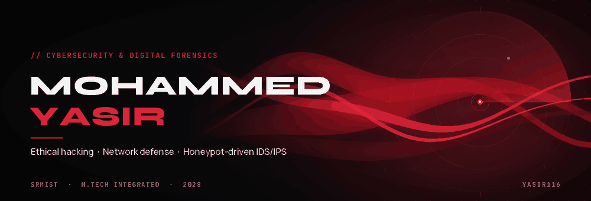
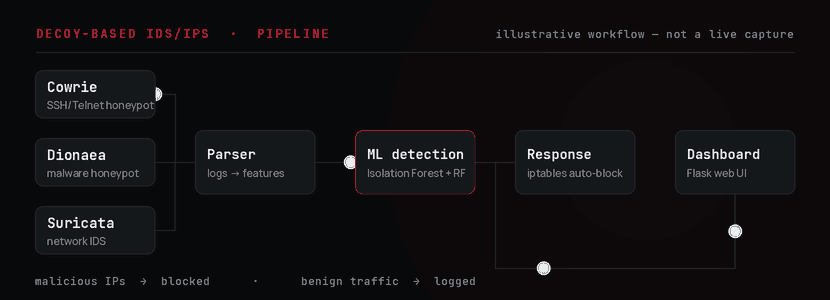
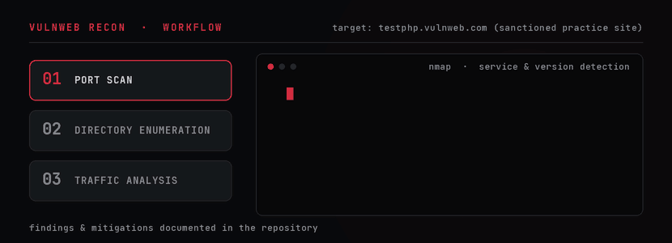
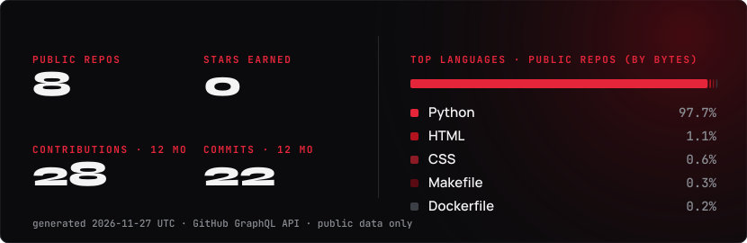

<a href="https://www.linkedin.com/in/smyasir-grad028/">LinkedIn</a> &nbsp;·&nbsp; <a href="https://tryhackme.com/p/JoyBoy025">TryHackMe</a>

 

I'm **Mohammed Yasir**, an M.Tech Integrated student in Computer Science & Engineering at **SRMIST, Chennai** (2023–2028), specialising in **Cybersecurity & Digital Forensics**.

My work sits on both sides of network security: **recon and vulnerability assessment** on the offensive side, and **honeypot-driven intrusion detection and prevention** on the defensive side. My main build so far is a decoy-based IDS/IPS that turns honeypot and Suricata logs into ML detections and automatic IP blocking, built with two teammates. Day to day I practise ethical hacking and penetration testing on Kali Linux, and I've interned in the field at **ShadowFox** and **CFSS Global**.

**Open to cybersecurity internships** (Chennai, hybrid or remote).

 

 
      

 
        

 
   

 
  

 

### [Decoy-Based IDS/IPS using Honeypot Logs](https://github.com/YASIR116/Decoy-Based-IDS-IPS-Using-Honeypot-Logs)
`Python` · `Flask` · `scikit-learn` · `Cowrie` · `Dionaea` · `Suricata` · `iptables`

Honeypots (**Cowrie**, **Dionaea**) and **Suricata** generate attack logs; a parser turns them into features, and **Isolation Forest + Random Forest** models flag malicious IPs. Flagged IPs are **blocked automatically with iptables** (with a 24-hour unblock), and a **Flask dashboard** shows what's happening.
*Team project with Jeyabalan and Sathyaseelan, Feb–Apr 2026.*

 

### [VulnWeb Recon & Traffic Analysis](https://github.com/YASIR116/VulnWeb-Recon-and-Traffic-Analysis)
`Nmap` · `Gobuster` · `Dirb` · `Wireshark` · `Kali Linux`

A documented three-phase recon exercise against Acunetix's intentionally vulnerable **testphp.vulnweb.com** (a sanctioned practice target): port scanning found **4 open ports**, directory enumeration surfaced exposed paths including a leftover **/CVS**, and a packet capture showed **login credentials sent in plaintext over HTTP**. Each phase has a write-up, plus a consolidated mitigations file.

 

#### More builds

<table>
<tr>
<td width="50%"><b><a href="https://github.com/YASIR116/MEWSIC">MEWSIC</a></b> Music recommendation web platform. <code>PHP</code> <code>MySQL</code> <code>HTML/CSS/JS</code></td>
<td width="50%"><b><a href="https://github.com/YASIR116/Rentify-">Rentify</a></b> Peer-to-peer platform for renting items. <code>Python</code></td>
</tr>
</table>

<!--
  READY TO PUBLISH? Once these repositories are public: move the two <td> cells below into the <table> above (or a new <table>), fix the URLs, and delete this comment wrapper.
  Only add a description you can stand behind (what it does, stack) - no claims you can't show.

<tr>
<td width="50%"><b><a href="https://github.com/YASIR116/REPO-NAME">AI Chess Game</a></b> One-line description. <code>Tech</code></td>
<td width="50%"><b><a href="https://github.com/YASIR116/REPO-NAME">Hospital Management System</a></b> One-line description. <code>Tech</code></td>
</tr>
-->

 

**Experience**

| Period | Role |
|---|---|
| 2026 | **Ethical Hacking & Penetration Testing Intern** · CFSS Global |
| Mar – Apr 2025 | **Cybersecurity Intern** · ShadowFox (remote) · Kali Linux, vulnerability scanning |

**Certifications**

| Certification | Issuer | Date |
|---|---|---|
| **Fortinet Network Security Expert Level 1: Certified Associate** | Fortinet | Issued Nov 2026 · expires Nov 2028 |
| **Certified Network Security Practitioner (CNSP)** | The SecOps Group | Issued Nov 2025 |
| **Check Point Certified Security Administrator (CCSA)** | Check Point | — |

**Education** — M.Tech Integrated, CSE with Cyber Security & Digital Forensics · SRMIST, Kattankulathur, Chennai · 2023–2028

 

 

 

  

 

